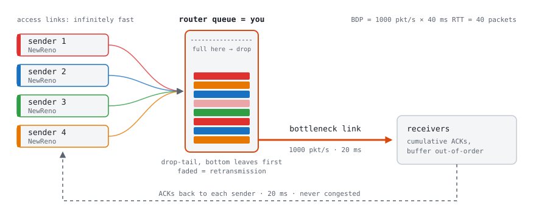

# packet-tycoon — design

> You are the router. Everyone is sending you packets. Your buffer is tiny.

## The idea

Most explanations of TCP congestion control are a sawtooth graph in a textbook.
I wanted to *feel* it: be the bottleneck router, watch senders ramp up, watch my
buffer fill, and decide who gets dropped. The senders are not scripted — they run
(simplified but real) congestion-control algorithms and react to my drops exactly
like they would on the internet. So if I play badly, I cause the problems real
networks have: bufferbloat, global synchronisation, unfair flows, timeouts.

## Topology

<picture>
  <source media="(prefers-color-scheme: dark)" srcset="docs/topology-dark.svg">
  
</picture>

- Access links from senders to the router are infinitely fast — the router is
  the only bottleneck, so everything interesting happens in one place: your queue.
- The bottleneck link serialises one packet every `1000 / rate` ms and delivers
  it after a fixed propagation delay.
- ACKs return over an uncongested path with a fixed delay.
- Every packet is the same size (1 "packet" = 1 MSS). Units are packets and ms.

## Simulation core (`src/sim`)

- **Discrete time, 1 ms ticks**, fully deterministic (seeded RNG for any
  randomness, e.g. RED). The renderer runs the simulation N ticks per animation
  frame, so game speed is just "ticks per frame". Same seed + same player input
  = same game, which makes the core unit-testable.
- **No event heap needed.** Because each path has a constant delay, packets on
  a path arrive in the order they were sent, so every in-flight path is a FIFO.
- **Queue disciplines** share one interface:
  `enqueue(pkt, now) → accepted?`, `dequeue(now) → pkt | undefined`.
  Drop-tail first; RED, CoDel and fair queueing come later as "power-ups".
- **Receivers** keep per-flow state and send *cumulative* ACKs (the next
  sequence number they expect). Out-of-order packets are buffered, so a single
  loss produces duplicate ACKs — the signal Reno reacts to.

## Congestion control (`src/sim/cc`)

### Reno / NewReno (first)
- Slow start: `cwnd += 1` per newly acked packet (doubles every RTT).
- Congestion avoidance: `cwnd += 1/cwnd` per ack (≈ +1 per RTT).
- 3 duplicate ACKs → fast retransmit, `ssthresh = cwnd/2`, `cwnd = ssthresh`,
  enter fast recovery. Partial ACKs retransmit the next hole (NewReno).
- Retransmission timeout (RTO from smoothed RTT, RFC 6298-style, min 200 ms)
  → `cwnd = 1`, go-back-N from the first unacked packet.

### Later
- **CUBIC** — window as a cubic function of time since last loss.
- **BBR-lite** — model-based: estimate bottleneck bandwidth and min RTT, pace at
  that rate. The fun part: BBR mostly ignores your drops, so it needs a different
  strategy to tame.

## Game layer

- **Levels** = topology + flows + goal + allowed tools. Example goals: keep p95
  queueing delay < 50 ms while utilisation > 90%; keep the video-call flow's
  latency low during the "Windows Update" burst; reach Jain's fairness index > 0.9.
- **Tools / power-ups:** click a packet to drop it, set the buffer size, then
  unlock automatic disciplines (RED, CoDel, FQ) as you progress.
- **Scoring** from the same metrics the sim already tracks: throughput,
  utilisation, queueing delay, drops, fairness.

## Rendering

Canvas 2D, decoupled from the sim. The router queue is drawn as a stack of
packets coloured by flow; below it, live charts of each flow's `cwnd` (the
famous sawtooth) and the queueing delay.

## Non-goals

Real packet formats, byte-level sequence numbers, SACK, delayed ACKs, the full
RFC state machines. The goal is behaviour that is *qualitatively right* and
explainable, not a ns-3 replacement.
