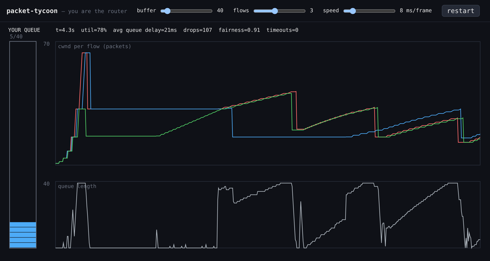
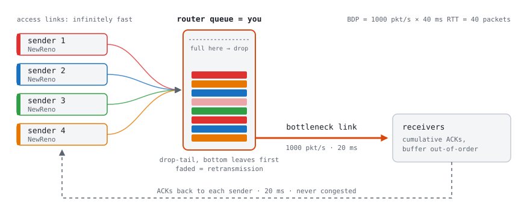

# packet-tycoon

**A browser game where you are the router.**

Everyone on the internet is sending you packets. Your buffer is tiny. The senders
aren't scripted bots — they run real (simplified) TCP congestion control, so
every packet you drop changes how they behave. Drop too few and your queue turns
into a 200 ms latency swamp. Drop too many and the link sits idle while
everybody backs off at once.

I built this because I'd stared at the TCP sawtooth graph in textbooks a dozen
times and never really *felt* why it happens. Now I can cause it on purpose.



> **Status:** the simulation core and a sandbox are working. Levels, goals,
> click-to-drop and unlockable queue algorithms (RED, CoDel, fair queueing) are next.

## What you're looking at

- **Left — your queue.** Every block is a packet, coloured by the flow that sent it
  (faded = retransmission). The bottom of the stack leaves next.
- **Top chart — each sender's congestion window (`cwnd`).** It's how many
  packets the sender allows itself to have in flight. Watch it double during slow
  start, then climb one packet per round trip, then get cut in half every time
  your queue overflows: the famous sawtooth.
- **Bottom chart — queue length.** When it sits near the top, every packet is
  waiting in line. That waiting *is* latency.

## Things I found playing with it

Single Reno flow, 1000 packets/s bottleneck, 40 ms round trip, so the
bandwidth-delay product (BDP) is **40 packets**. 30 simulated seconds each:

| Router buffer | Link utilisation | Avg. queueing delay |
|---:|---:|---:|
| 10 packets | 48.5 % | 1.9 ms |
| **40 packets (= BDP)** | **98.0 %** | 22 ms |
| 200 packets | 99.3 % | 125 ms |
| 2000 packets | 99.4 % | 134 ms |

That table is the whole buffer-sizing debate in four rows:

- **Below the BDP**, the link goes idle after every loss, while the halved window refills.
- **Around the BDP** you get almost full throughput with modest delay. This is the
  classic "buffer = bandwidth × RTT" rule of thumb.
- **Past that, a bigger buffer buys you basically nothing but latency.** That's
  [bufferbloat](https://en.wikipedia.org/wiki/Bufferbloat), and it's why your video
  call stutters when someone starts a big download.

With 3+ flows sharing a small drop-tail buffer you can also see **global
synchronisation**: one overflow drops packets from *every* flow at once, so they
all halve together and the link briefly goes quiet. That's one of the original
motivations for RED.

## How it works

<picture>
  <source media="(prefers-color-scheme: dark)" srcset="docs/topology-dark.svg">
  
</picture>

- **Deterministic 1 ms ticks.** The renderer just runs N ticks per animation
  frame, so "game speed" is a slider and the whole simulation is unit-testable.
- **No event heap.** Every path has a constant delay, so packets on it arrive in
  the order they were sent. Each in-flight path is just a FIFO.
- **NewReno senders** ([`src/sim/cc/reno.ts`](src/sim/cc/reno.ts)): slow start,
  congestion avoidance, fast retransmit on 3 duplicate ACKs, fast recovery with
  partial-ACK retransmits, and an RFC 6298 RTO estimator with exponential backoff.
- **Receivers** send cumulative ACKs and buffer out-of-order packets, so one lost
  packet produces the duplicate ACKs that trigger fast retransmit.
- **Queue disciplines** implement one small interface (`enqueue` / `dequeue`), so
  RED, CoDel and fair queueing will plug in as "power-ups".

The full reasoning is in [DESIGN.md](DESIGN.md).

## Run it

```sh
npm install
npm run dev     # play
npm test        # 16 tests: unit tests + end-to-end behaviour (saturation, bufferbloat, fairness)
```

## Honest limitations

- Whole-packet sequence numbers, no SACK, no delayed ACKs, and no window
  inflation during fast recovery. After a burst of losses, a sender goes quiet and
  repairs **one hole per round trip** (that's real NewReno behaviour, and you can
  see the long flat stretches in the screenshot). That's also why utilisation
  with a tiny buffer is lower than the textbook ~75 %.
- All flows have the same RTT. Mixed RTTs (and the unfairness they cause) are on
  the roadmap.

## Roadmap

- [x] Simulation core: queue, link, receivers, NewReno, metrics
- [x] Sandbox with live charts
- [ ] Click packets to drop them; levels with goals and scores
- [ ] Power-ups: RED, CoDel, fair queueing
- [ ] More senders: CUBIC, BBR-lite (good luck taming that one)
- [ ] Mixed RTTs, bursty "Windows Update" traffic, a latency-sensitive video-call flow

## License

MIT
