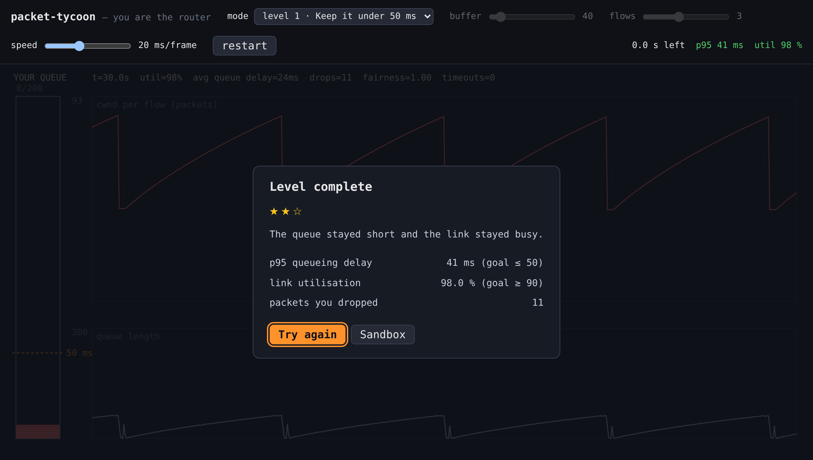

# packet-tycoon

**A browser game where you are the router.**

Everyone on the internet is sending you packets. Your buffer is tiny. The senders
aren't scripted bots — they run real (simplified) TCP congestion control, so
every packet you drop changes how they behave. Drop too few and your queue turns
into a 200 ms latency swamp. Drop too many and the link sits idle while
everybody backs off at once.

I built this because I'd stared at the TCP sawtooth graph in textbooks a dozen
times and never really *felt* why it happens. Now I can cause it on purpose.


> **Status:** the sandbox and two levels are playable: click packets in the queue
> to drop them. More levels and unlockable queue algorithms (RED, CoDel, fair
> queueing) are next.

## Level 1: Keep it under 50 ms

Someone gave the router a 200-packet buffer. Left alone, a single Reno sender
fills it and the 95th-percentile wait climbs past 150 ms. Your job is to click
packets out of the queue so that 95 % of packets wait at most 50 ms, while the
link stays at least 90 % busy.



Each click is a loss signal, so the sender halves its window and the queue
drains. Click too often and the link goes idle. Click too late and the tail
delay blows the goal. With one Reno flow you can't beat the buffer-size
trade-off from the table below, only hug it: passing means a p95 somewhere
between about 36 and 50 ms, and the stars reward getting close to 40.

## What you're looking at

- **Left — your queue.** Every block is a packet, coloured by the flow that sent it
  (faded = retransmission). The bottom of the stack leaves next.
- **Top chart — each sender's congestion window (`cwnd`).** It's how many
  packets the sender allows itself to have in flight. Watch it double during slow
  start, then climb one packet per round trip, then get cut in half every time
  your queue overflows: the famous sawtooth.
- **Bottom chart — queue length.** When it sits near the top, every packet is
  waiting in line. That waiting *is* latency.

## Level 2: One at a time

Four senders, a 120-packet buffer, and a stricter goal: p95 wait ≤ 30 ms with
the link ≥ 96 % busy. The obvious move from level 1 (keep the queue under a
line) fails here. I wrote little scripted players to balance the level, and
they showed why:

| Strategy | p95 queueing delay | Link utilisation | Drops | Timeouts |
|---|---:|---:|---:|---:|
| do nothing | 119 ms | 99.5 % | 150 | 2 |
| drop everything above 30 | 30 ms | 93.9 % | 196 | 0 |
| one drop per RTT, newest packet | 30 ms | 98.2 % | 153 | 1 |
| one drop per RTT, biggest flow | 31 ms | 97.7 % | 148 | 3 |
| one drop per RTT, oldest packet | 29 ms | 98.2 % | 116 | 0 |

Clipping the queue at a line drops a burst, the burst hits several flows, and
they all halve their windows in the same round trip. That's global
synchronisation, and the link goes quiet. Spacing drops one round trip apart
gets about 4 % more throughput at the same delay.

I expected *which* flow you punish to matter most, but it barely does. Pacing
is what matters. Dropping the **oldest** packet is best: same throughput with
37 fewer drops and no timeouts, because the sender learns about the loss a
whole queue's worth of waiting earlier. It's also one of the reasons CoDel drops
from the head of the queue.

## Things I found playing with it

Single Reno flow, 1000 packets/s bottleneck, 40 ms round trip, so the
bandwidth-delay product (BDP) is **40 packets**. 30 simulated seconds each:

| Router buffer | Link utilisation | Avg. queueing delay |
|---:|---:|---:|
| 10 packets | 48.5 % | 1.9 ms |
| **40 packets (= BDP)** | **98.0 %** | 22 ms |
| 200 packets | 99.3 % | 125 ms |
| 2000 packets | 99.4 % | 134 ms |

That table is the whole buffer-sizing debate in four rows:

- **Below the BDP**, the link goes idle after every loss, while the halved window refills.
- **Around the BDP** you get almost full throughput with modest delay. This is the
  classic "buffer = bandwidth × RTT" rule of thumb.
- **Past that, a bigger buffer buys you basically nothing but latency.** That's
  [bufferbloat](https://en.wikipedia.org/wiki/Bufferbloat), and it's why your video
  call stutters when someone starts a big download.

With 3+ flows sharing a small drop-tail buffer you can also see **global
synchronisation**: one overflow drops packets from *every* flow at once, so they
all halve together and the link briefly goes quiet. That's one of the original
motivations for RED.

### More flows than the pipe can hold

Same link, a 40-packet buffer, more and more senders:

| Flows | Link utilisation | Avg. queueing delay | Jain fairness | Drops | Timeouts |
|---:|---:|---:|---:|---:|---:|
| 1 | 98.0 % | 22 ms | 1.000 | 11 | 0 |
| 2 | 95.1 % | 22 ms | 0.999 | 88 | 0 |
| 4 | 95.2 % | 24 ms | 0.997 | 220 | 0 |
| 8 | 97.0 % | 25 ms | 0.992 | 497 | 0 |
| 16 | 97.1 % | 25 ms | 0.974 | 1190 | 82 |
| 32 | 95.2 % | 25 ms | 0.911 | 2773 | 1518 |

Up to 8 flows nothing dramatic happens. Then the timeouts column explodes.
The pipe plus the buffer hold about 80 packets, so 32 flows get roughly 2–3
packets of window each. Fast retransmit needs **three duplicate ACKs**, which
needs at least four packets in flight. With fewer, a single loss can't be
detected quickly, so the sender sits out a whole retransmission timeout (200 ms
minimum, five round trips here). Whoever times out falls behind, and fairness
starts to slip. Robert Morris described this many-flows regime in "TCP Behavior
with Many Flows" (1997), and it was fun to watch it show up in a sim without me
building anything for it.

Both tables come straight out of `npm run experiments`
([`scripts/experiments.ts`](scripts/experiments.ts)). The sim is deterministic,
so you'll get the same numbers.

## How it works

<picture>
  <source media="(prefers-color-scheme: dark)" srcset="docs/topology-dark.svg">
  
</picture>

- **Deterministic 1 ms ticks.** The renderer just runs N ticks per animation
  frame, so "game speed" is a slider and the whole simulation is unit-testable.
- **No event heap.** Every path has a constant delay, so packets on it arrive in
  the order they were sent. Each in-flight path is just a FIFO.
- **NewReno senders** ([`src/sim/cc/reno.ts`](src/sim/cc/reno.ts)): slow start,
  congestion avoidance, fast retransmit on 3 duplicate ACKs, fast recovery with
  partial-ACK retransmits, and an RFC 6298 RTO estimator with exponential backoff.
- **Receivers** send cumulative ACKs and buffer out-of-order packets, so one lost
  packet produces the duplicate ACKs that trigger fast retransmit.
- **Queue disciplines** implement one small interface (`enqueue` / `dequeue`), so
  RED, CoDel and fair queueing will plug in as "power-ups".

The full reasoning is in [DESIGN.md](DESIGN.md).

## Run it

```sh
npm install
npm run dev     # play
npm test        # 31 tests: unit, end-to-end behaviour, and that the levels are winnable
npm run experiments   # regenerate every table in this README
```

## Limitations

- Whole-packet sequence numbers, no SACK, no delayed ACKs, and no window
  inflation during fast recovery. After a burst of losses, a sender goes quiet and
  repairs **one hole per round trip** (that's real NewReno behaviour, and you can
  see the long flat stretches in the screenshot). That's also why utilisation
  with a tiny buffer is lower than the textbook ~75 %.
- All flows have the same RTT. Mixed RTTs (and the unfairness they cause) are on
  the roadmap.

## Roadmap

- [x] Simulation core: queue, link, receivers, NewReno, metrics
- [x] Sandbox with live charts
- [x] Click packets to drop them; level system with goals, stars and a score screen
- [x] Level 2: four flows, pace your drops
- [ ] More levels (a latency-sensitive video call, a bursty download)
- [ ] Power-ups: RED, CoDel, fair queueing
- [ ] More senders: CUBIC, BBR-lite (good luck taming that one)
- [ ] Mixed RTTs, bursty "Windows Update" traffic, a latency-sensitive video-call flow

## License

MIT
